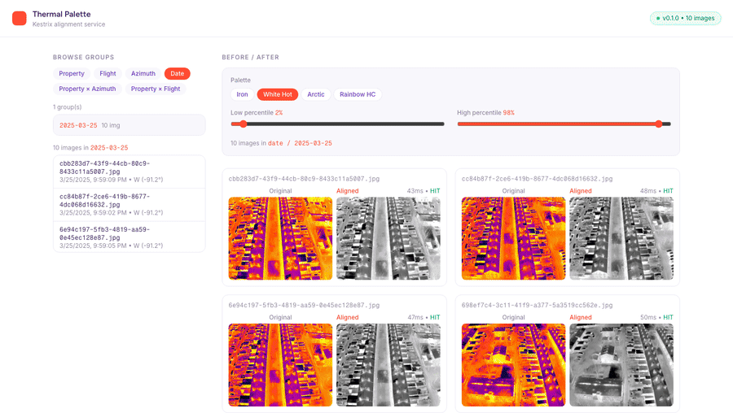
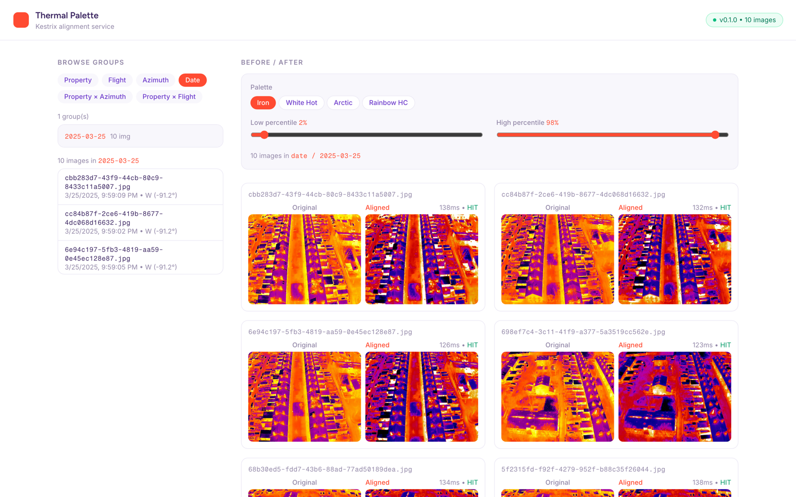
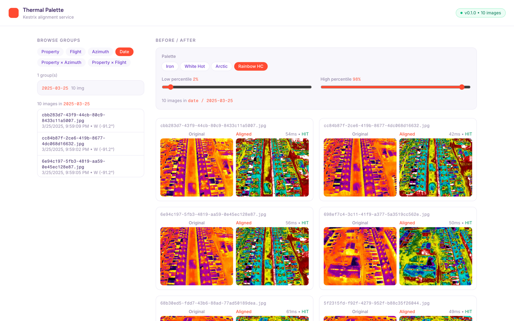
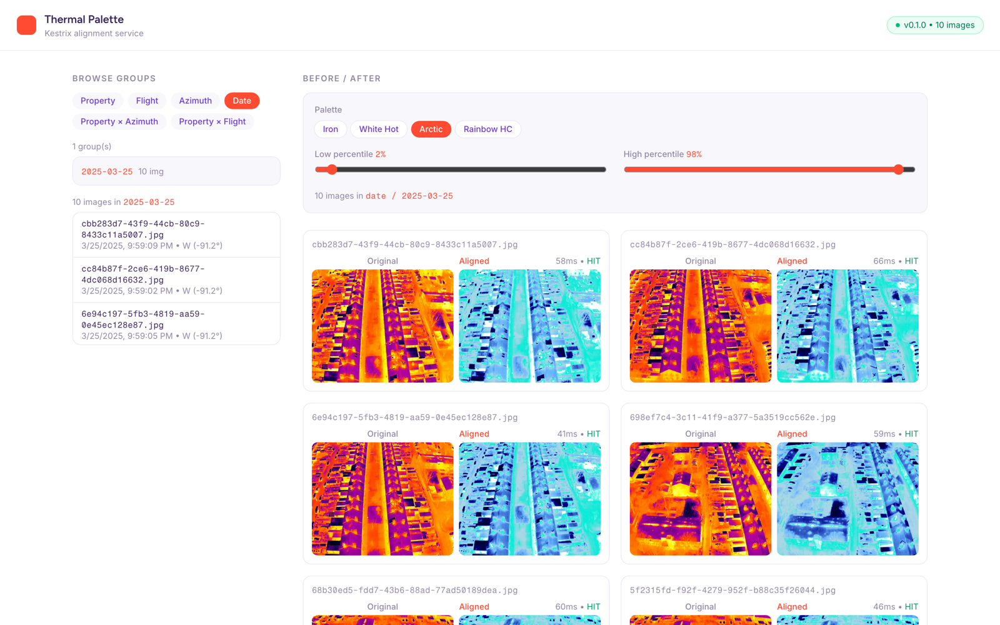
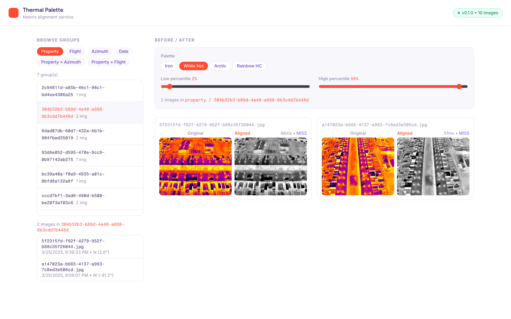

# Thermal Palette: alignment UI

A Next.js front end for comparing drone thermal images before and after palette alignment. Pick
how to group the images (by property, flight, compass direction or date), choose a group, and see
every image side by side: the original, and the same image re-rendered on the group's shared
temperature range, so that a colour means the same temperature in every photo.

It talks to the [kestrix_api](https://github.com/RitvikJoshi97/kestrix_api) service. Built as a
take-home assessment for Kestrix.



| Iron | Rainbow HC |
|---|---|
|  |  |
| **Arctic** | **Grouped by property** |
|  |  |

## Features

- **Six ways to group images:** property, flight, azimuth, date, property × azimuth and
  property × flight
- **Before and after** for every image in a group, with the render time and whether the shared
  range came from the API's cache
- **Four palettes:** Iron, White Hot, Arctic and Rainbow HC
- **Percentile sliders** for the low and high ends of the shared temperature range
- **Health badge** showing the API version and image count

## Run it

Requires Node.js 20 or later, and the API running locally (see
[kestrix_api](https://github.com/RitvikJoshi97/kestrix_api#run-it)).

```bash
npm install
NEXT_PUBLIC_API_URL=http://localhost:8000 npm run dev
```

Open http://localhost:3000. `NEXT_PUBLIC_API_URL` defaults to `http://localhost:8000`.

## Project structure

```
app/page.tsx              # page layout
components/
├── GroupBrowser.tsx      # grouping tabs and group list
├── RenderView.tsx        # original vs aligned grid, palette and percentile controls
└── HealthBadge.tsx       # API status
lib/api.ts                # typed API client
```

Built with Next.js, React, TypeScript and Tailwind CSS.
